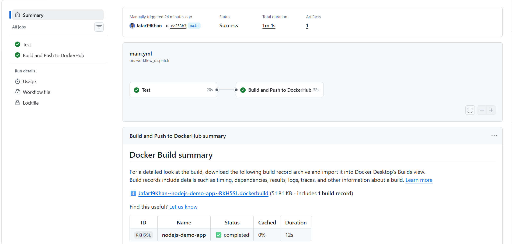

# Node.js CI/CD Pipeline with GitHub Actions and Docker

Automated CI/CD pipeline that tests a Node.js (Express) app, verifies the Docker image with a smoke test, and pushes it to Docker Hub on every push to `main`.

## Tech Stack

GitHub, GitHub Actions, Node.js 22, Express, Jest + Supertest, Docker, Docker Hub

## Pipeline Flow

```text
push to main
   |
   v
[Job 1: Test]
  npm ci -> npm test (Jest) -> docker build -> container smoke test (/health)
   |  (needs: test)
   v
[Job 2: Build and Push]
  Docker Buildx -> DockerHub login (secrets) -> build -> push
  tags: latest + sha-<commit>
```

- Pull requests to `main` run only the **Test** job (no image is pushed).
- The **Build and Push** job runs only on push to `main` and only if tests pass.

## Project Structure

```text
nodejs-demo-app/
├── .github/workflows/main.yml   # CI/CD pipeline
├── screenshots/                 # proof of working pipeline
├── app.js                       # Express app (routes)
├── server.js                    # server entry point
├── app.test.js                  # Jest + Supertest tests
├── Dockerfile
├── .dockerignore
├── .gitignore
├── package.json
├── package-lock.json
└── README.md
```

## Endpoints

| Route | Response |
|---|---|
| `GET /` | Greeting text |
| `GET /health` | `{"status":"healthy"}` |

## Run Locally

```bash
npm ci
npm test
npm start
# open http://localhost:3000
```

## Run with Docker

```bash
docker build -t nodejs-demo-app .
docker run -d -p 3000:3000 --name nodejs-demo nodejs-demo-app
curl http://localhost:3000/health
```

## Pull the Published Image

```bash
docker pull <DOCKERHUB_USERNAME>/nodejs-demo-app:latest
docker run -d -p 3000:3000 <DOCKERHUB_USERNAME>/nodejs-demo-app:latest
```

## GitHub Secrets Required

Repository -> Settings -> Secrets and variables -> Actions:

- `DOCKERHUB_USERNAME`: Docker Hub username
- `DOCKERHUB_TOKEN`: Docker Hub access token (Read & Write)

Secrets are never hardcoded; GitHub masks them in logs.

## Key Features

- Separate **test** and **build/push** jobs connected with `needs`
- Real unit tests, plus a container smoke test before pushing the image
- Two image tags: `latest` and commit SHA (for traceability and rollback)
- Docker layer caching to speed up builds
- Least-privilege workflow permissions and `concurrency` to cancel duplicate runs
- Hardened image: non-root user, `HEALTHCHECK`, small Alpine base, `.dockerignore`

## Screenshots

Add your screenshots to the `screenshots/` folder and update the filenames below.





## What I Learned

- How CI/CD works end to end: triggers, jobs, steps, runners and secrets
- The Docker build and push workflow with GitHub Actions
- Tagging images by commit SHA and verifying them with a smoke test before release
